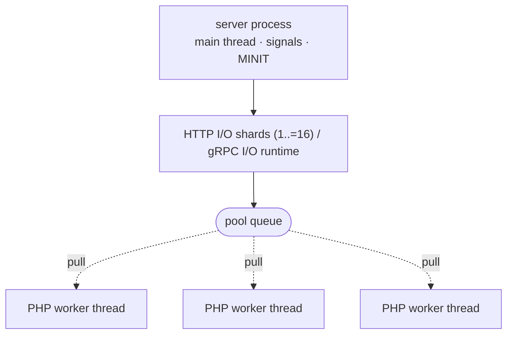

# Process model

Rapira runs one server process for all enabled protocols. The process owns the listeners, the initialized PHP engine, the pidfile, and one worker pool for each enabled protocol. Each pool has a bounded queue and a fixed number of thread-safe (ZTS) PHP worker threads.

HTTP and [gRPC](./grpc) have separate listeners, entrypoints, queues, and pools. `[http.pool]` and `[grpc.pool]` configure them independently. The gRPC pool uses Dispatcher mode and handles one active call per worker.

When the configuration has an `[observability]` table, Rapira starts a listener on a separate thread (`rapira-obs`) inside the same process. This thread runs no PHP code. A reload does not change it, because it has no app to restart. See [Metrics and health checks](/docs/observability) for more information.

This architecture is the same in [Classic](/docs/classic), [Worker](/docs/worker), and [Dispatcher](/docs/dispatcher) modes. `http.pool.mode` controls request processing inside a worker thread. It does not change pool creation, recycling, or reloads. See [Execution modes](/docs/execution-modes) for more information.

## Server and workers

Initialization uses this order:

1. **Validate configuration and NTS limits.** On an NTS build, Rapira refuses a second PHP pool and limits a single pool to one worker.
2. **Bind the listen sockets.** A port conflict stops initialization before PHP starts.
3. **Start PHP once.** The main thread runs `MINIT` and initializes OPcache in shared process memory.
4. **Start the I/O runtimes and worker threads.** Each pool spawns its configured PHP worker threads.



The HTTP plugin runs dedicated single-threaded I/O shards, one per CPU clamped to `1..=16`. The gRPC plugin uses a multi-thread I/O runtime with one thread per CPU. HTTP-only servers use a single-thread control runtime. Each PHP worker thread pulls units from its pool queue.

With ZTS, each PHP worker thread has its own working directory and thread-local `putenv()` layer. The process ID, `umask()`, and `setlocale()` are shared across all threads in the server process. A build linked to NTS PHP runs one worker, logs a warning if `workers` is higher, and refuses a second PHP pool.

::: info
The server runs PHP module shutdown on the main thread after all PHP worker threads join.
:::

## Pool management {#pool-management}

- **Boot failures.** In Worker and Dispatcher modes, a boot fails when the entry script ends before it receives a unit. The retry delay starts at 500 ms, doubles after each consecutive boot failure, and stops at 5 seconds. An incoming unit during the wait does not start the next boot early; while no worker in the pool is ready, queued units receive HTTP `503` or gRPC `UNAVAILABLE`. A boot that succeeds resets the failure count and delay.
- **Stop on boot failure.** `max_boot_failures` limits consecutive failed boots (default `5`; `0` disables the limit). When a worker reaches the limit before its pool has served any unit, Rapira exits with code `70`. After the pool has served a unit, the worker keeps retrying with backoff instead of stopping the server.
- **App recycling.** In Worker and Dispatcher modes, `max_requests` limits the units of one app instance. After a random count between `max_requests + 1` and approximately `1.5 × max_requests`, the worker recycles its app on the same thread. Listeners, connections, and the pool queue stay. Classic mode ignores this key.
- **Request timeout watchdog.** `request_terminate_timeout_secs` sets a wall-clock limit for one unit. At the limit, the watchdog interrupts PHP and wakes a blocked response write. Native I/O can continue waiting, so set timeouts on sockets and database calls. After five more seconds, Rapira logs a still-blocked worker once while other workers keep serving. Rapira exits with code `124` only if every worker in one pool stays blocked after the grace period.
- **Watchdog signal (`SIGRTMAX`).** On Linux and other platforms with `SIGRTMAX`, an enabled watchdog reserves `SIGRTMAX` before workers start. Startup fails if the main thread blocks it or the process already handles or ignores it. Apps and extensions must leave `SIGRTMAX` available. macOS uses PHP interrupt flags without a native wake signal.
- **Execution timers (`execution_clock`).** On Linux with per-thread PHP timers, `max_execution_time` counts wall-clock time by default and pauses while waiting for work or response stream space. Set `execution_clock = "cpu"` in a pool to count only worker thread CPU time, so `sleep()` and database waits do not consume the budget. Without per-thread timers and with multiple workers, Rapira sets `max_execution_time=0` and `max_input_time=-1`, while `request_terminate_timeout_secs` still applies.

## Pool size

The settings below use `[http.pool]`. The same settings apply to `[grpc.pool]`.

`http.pool.workers` sets the worker thread count. The default value is one worker for each CPU that the process can use. If a container has a CPU limit, the default follows that limit.

PHP is synchronous, so each worker thread handles one unit at a time. I/O-bound applications can require more workers than CPU cores. CPU-bound applications usually do not.

The worker count does not change while the server runs. To change capacity with the load, change the number of Rapira instances, for example with a container orchestrator.

See [configuration](/docs/configuration) for the complete key reference.

## Signals {#signals}

Signals stop a running server, reload it, and make it report its state. Send signals to the `rapira` process:

| Signal | What the server does |
| --- | --- |
| `SIGTERM`, `SIGINT` | Closes listeners, drains open connections, and stops workers. A second `SIGTERM` or `SIGINT` forces exit `130`. |
| `SIGQUIT` | Performs the same drain and stop. A second `SIGQUIT` has no effect. |
| `SIGUSR2`, `SIGHUP` | Reloads the app in every worker of every pool. |
| `SIGUSR1` | Writes pool and worker status to the log. |

Set `server.pidfile` to give scripts a stable location for the server process identifier:

```bash
kill -USR2 $(cat /run/rapira.pid)   # Reload the app in each worker.
kill -USR1 $(cat /run/rapira.pid)   # Write pool status to the log.
kill -TERM $(cat /run/rapira.pid)   # Stop after open connections drain.
```

### Stopping

After `SIGTERM`, `SIGINT`, or `SIGQUIT`, Rapira closes its listeners and stops accepting new connections. Open connections drain for `[server].stop_timeout_secs` minus five seconds, or half the timeout if it is below ten seconds. The default stop timeout is 30 seconds, which gives a 25-second drain window and 5 seconds for PHP shutdown.

When the stop timeout expires, Rapira exits immediately. A second `SIGTERM` or `SIGINT` during drain forces an immediate exit with code `130`. See [Exit codes](/docs/cli#exit-codes) for all exit codes.

### A reload restarts the apps {#a-reload-restarts-the-apps}

`SIGUSR2` or `SIGHUP` recycles the app in each worker of each pool. Before the entry script runs again, the worker resolves symbolic links in the entry script path, clears the PHP realpath cache, and enters the resolved script directory. Listeners, connections, and queued units stay.

In Classic mode, each request runs the entry script in a new PHP request. Thus, a changed file takes effect without a reload, except with `opcache.validate_timestamps = 0`. A deployment that switches a symbolic link in the entry script path needs a reload in all modes, Classic mode included. Worker and Dispatcher modes keep the application in memory, so reload after each deployment. See [deployment](/docs/deployment) for more information.

A reload resets OPcache so apps load new code also when `opcache.validate_timestamps = 0`. The `manual_restarts` value of `opcache_get_status()` counts these reloads. One worker performs `opcache_reset()` while peers wait, and subsequent requests recompile changed scripts. With `opcache.file_cache` and `opcache.validate_timestamps = 0`, a reload does not load the new code of a changed file in any mode: see [deployment](/docs/deployment).

Rapira ignores reload signals during a stop.

::: info
A reload recycles the apps but does not restart the server process. Restart Rapira to apply changes to the binary, `rapira.toml`, `php.ini`, `grpc.descriptor_set`, `grpc.auth.tokens_file`, or files loaded by `opcache.preload`.
:::

OPcache schedules a restart when app code calls `opcache_reset()` or when the cache is full. Rapira then reloads every pool and logs a warning. Under Rapira, the default `opcache.force_restart_timeout` is `0`, and a value in `php.ini` overrides it. Keep the value `0` so OPcache does not kill active workers during a restart.

### Writing status to the log

`SIGUSR1` writes the status of each pool and worker to the log on the `rapira` target at `info` level:

```text
pool=http workers=4 pending=0 failed_on_full_queue=0 refused=0
pool=http worker=0 state=idle handled=1500 errors=2 recycles=0 last_activity_ms=42100
```

| State | Meaning |
| --- | --- |
| `starting` | The application has not booted yet, or its last boot failed. |
| `idle` | The worker waits for work. |
| `active` | The worker processes a unit. |
| `draining` | The worker finishes its work and stops. |

`recycles` counts app recycles on that worker thread, for example after `max_requests`, a fatal error, or a reload.

::: tip
The status output uses `info` on the `rapira` target. The default log level is `error`. Set this target to `info` to show the output:

```toml
[log.targets]
rapira = "info"
```

See [logging](/docs/logging) for more information.
:::

::: question Does Rapira use transparent huge pages?
No. On Linux, Rapira disables transparent huge pages for its process before PHP starts. Child processes that PHP starts with `proc_open()` or `exec()` inherit this setting. Thus, `USE_ZEND_ALLOC_HUGE_PAGES=1` and `opcache.huge_code_pages` get no transparent huge pages. These options can still use explicit huge pages reserved with `vm.nr_hugepages`.
:::

::: question Can Rapira run as PID 1 in a container?
No. Run containers with `docker run --init` so that an init process removes exited child processes started by PHP.
:::
