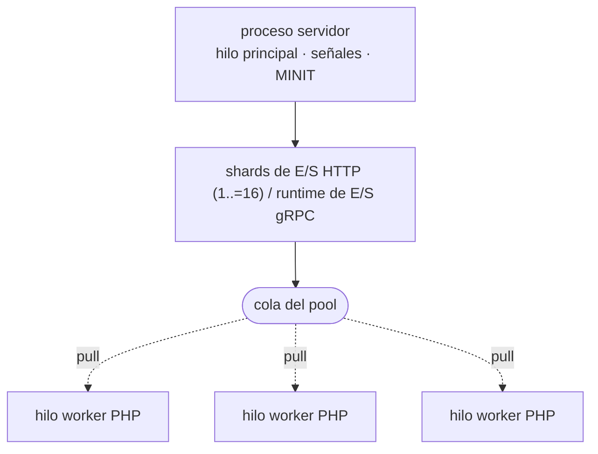

# Modelo de procesos

Rapira ejecuta un proceso del servidor para todos los protocolos activados. El proceso posee las escuchas, el motor PHP inicializado, el pidfile y un pool de workers para cada protocolo activado. Cada pool tiene una cola acotada y un número fijo de hilos worker de PHP thread-safe (ZTS).

HTTP y [gRPC](/es/docs/grpc) tienen escuchas, scripts de entrada, colas y pools separados. `[http.pool]` y `[grpc.pool]` los configuran de forma independiente. El pool gRPC usa el modo Dispatcher y procesa una llamada activa por worker.

Cuando la configuración tiene una tabla `[observability]`, Rapira inicia una escucha en un hilo separado (`rapira-obs`) dentro del mismo proceso. Este hilo no ejecuta código PHP. Una recarga no lo cambia, porque no tiene ninguna aplicación que reiniciar. Consulta [Métricas y comprobaciones de estado](/es/docs/observability) para más información.

Esta arquitectura es la misma en los modos [Classic](/es/docs/classic), [Worker](/es/docs/worker) y [Dispatcher](/es/docs/dispatcher). `http.pool.mode` controla el procesamiento de las peticiones dentro de un hilo worker. No cambia la creación del pool, el reciclaje ni las recargas. Consulta [Modos de ejecución](/es/docs/execution-modes) para más información.

## Servidor y workers

La inicialización sigue este orden:

1. **Validar la configuración y los límites de NTS.** En una compilación NTS, Rapira rechaza un segundo pool PHP y limita un único pool a un worker.
2. **Enlazar los sockets de escucha.** Un conflicto de puerto detiene la inicialización antes de que PHP se inicie.
3. **Iniciar PHP una vez.** El hilo principal ejecuta `MINIT` e inicializa OPcache en la memoria compartida del proceso.
4. **Iniciar los runtimes de E/S y los hilos worker.** Cada pool inicia sus hilos worker PHP configurados.



El plugin HTTP ejecuta shards de E/S dedicados de un solo hilo, uno por CPU limitado al rango `1..=16`. El plugin gRPC usa un runtime de E/S multihilo con un hilo por CPU. Los servidores solo HTTP usan un runtime de control de un solo hilo. Cada hilo worker de PHP toma unidades de la cola de su pool.

Con ZTS, cada hilo worker de PHP tiene su propio directorio de trabajo y su capa `putenv()` local al hilo. El identificador de proceso, `umask()` y `setlocale()` se comparten entre todos los hilos del proceso del servidor. Una compilación enlazada con PHP NTS ejecuta un worker, registra una advertencia si `workers` es mayor y rechaza un segundo pool PHP.

::: info
El servidor ejecuta el cierre de los módulos de PHP en el hilo principal después de que todos los hilos worker de PHP finalicen.
:::

## Gestión del pool {#pool-management}

- **Fallos de arranque.** En los modos Worker y Dispatcher, un arranque falla cuando el script de entrada termina antes de recibir una unidad. El tiempo de espera entre reintentos empieza en 500 ms, se duplica tras cada fallo consecutivo de arranque y se detiene en 5 segundos. Una unidad entrante durante la espera no inicia el siguiente arranque antes de tiempo; mientras ningún worker del pool está listo, las unidades en cola reciben HTTP `503` o gRPC `UNAVAILABLE`. Un arranque correcto reinicia el contador de fallos y la espera.
- **Parada por fallo de arranque.** `max_boot_failures` limita los arranques fallidos consecutivos (por defecto `5`; `0` desactiva el límite). Cuando un worker alcanza el límite antes de que su pool haya atendido ninguna unidad, Rapira sale con el código `70`. Después de que el pool haya atendido una unidad, el worker sigue reintentando con espera progresiva en lugar de detener el servidor.
- **Reciclaje de la aplicación.** En los modos Worker y Dispatcher, `max_requests` limita las unidades de una instancia de la aplicación. Después de un número aleatorio entre `max_requests + 1` y aproximadamente `1.5 × max_requests`, el worker recicla su aplicación en el mismo hilo. Las escuchas, las conexiones y la cola del pool se mantienen. El modo Classic ignora esta clave.
- **Watchdog de tiempo límite de petición.** `request_terminate_timeout_secs` establece un límite de tiempo real para una unidad. Al alcanzarse el límite, el watchdog interrumpe PHP y despierta una escritura de respuesta bloqueada. La E/S nativa puede seguir esperando, por lo que debes configurar tiempos límite en los sockets y en las llamadas a bases de datos. Después de cinco segundos más, Rapira registra una vez un worker que sigue bloqueado mientras los demás workers siguen atendiendo peticiones. Rapira sale con el código `124` solo si todos los workers de un pool permanecen bloqueados después del plazo de gracia.
- **Señal del watchdog (`SIGRTMAX`).** En Linux y otras plataformas con `SIGRTMAX`, un watchdog activado reserva `SIGRTMAX` antes de que arranquen los workers. El arranque falla si el hilo principal la bloquea o si el proceso ya la maneja o la ignora. Las aplicaciones y las extensiones deben dejar `SIGRTMAX` disponible. macOS usa indicadores de interrupción de PHP sin una señal nativa de despertar.
- **Temporizadores de ejecución (`execution_clock`).** En Linux con temporizadores PHP por hilo, `max_execution_time` cuenta el tiempo real por defecto y se pausa mientras espera trabajo o espacio en el stream de respuesta. Establece `execution_clock = "cpu"` en un pool para contar solo el tiempo de CPU del hilo worker, de modo que `sleep()` y las esperas de base de datos no consuman el presupuesto. Sin temporizadores por hilo y con múltiples workers, Rapira establece `max_execution_time=0` y `max_input_time=-1`, mientras que `request_terminate_timeout_secs` sigue aplicándose.

## Tamaño del pool

Los ajustes siguientes usan `[http.pool]`. Los mismos ajustes se aplican a `[grpc.pool]`.

`http.pool.workers` establece el número de hilos worker. El valor predeterminado es un worker por cada CPU que el proceso puede usar. Si un contenedor tiene un límite de CPU, el valor predeterminado sigue ese límite.

PHP es síncrono, por lo que cada hilo worker procesa una unidad cada vez. Las aplicaciones con mucha E/S pueden requerir más workers que núcleos de CPU. Las aplicaciones limitadas por CPU normalmente no los requieren.

El número de workers no cambia mientras el servidor está en marcha. Para cambiar la capacidad según la carga, cambia el número de instancias de Rapira, por ejemplo con un orquestador de contenedores.

Consulta [configuración](/es/docs/configuration) para ver la referencia completa de claves.

## Señales {#signals}

Las señales detienen un servidor en marcha, lo recargan y le hacen informar de su estado. Envía las señales al proceso `rapira`:

| Señal | Qué hace el servidor |
| --- | --- |
| `SIGTERM`, `SIGINT` | Cierra las escuchas, drena las conexiones abiertas y detiene los workers. Un segundo `SIGTERM` o `SIGINT` fuerza la salida `130`. |
| `SIGQUIT` | Realiza el mismo drenaje y parada. Un segundo `SIGQUIT` no tiene efecto. |
| `SIGUSR2`, `SIGHUP` | Recarga la aplicación en todos los workers de todos los pools. |
| `SIGUSR1` | Escribe el estado de los pools y los workers en el registro. |

Define `server.pidfile` para dar a los scripts una ubicación fija del identificador del proceso del servidor:

```bash
kill -USR2 $(cat /run/rapira.pid)   # Recargar la aplicación en cada worker.
kill -USR1 $(cat /run/rapira.pid)   # Escribir el estado del pool en el registro.
kill -TERM $(cat /run/rapira.pid)   # Detener después de drenar las conexiones abiertas.
```

### Parada

Después de `SIGTERM`, `SIGINT` o `SIGQUIT`, Rapira cierra sus escuchas y deja de aceptar conexiones nuevas. Las conexiones abiertas drenan durante `[server].stop_timeout_secs` menos cinco segundos, o la mitad del tiempo límite si es menor de diez segundos. El tiempo límite de parada predeterminado es de 30 segundos, lo que da un margen de drenaje de 25 segundos y 5 segundos para el cierre de PHP.

Cuando vence el tiempo límite de parada, Rapira sale inmediatamente. Un segundo `SIGTERM` o `SIGINT` durante el drenaje fuerza una salida inmediata con el código `130`. Consulta [Códigos de salida](/es/docs/cli#exit-codes) para ver todos los códigos de salida.

### Una recarga reinicia las aplicaciones {#a-reload-restarts-the-apps}

`SIGUSR2` o `SIGHUP` recicla la aplicación en cada worker de cada pool. Antes de que el script de entrada vuelva a ejecutarse, el worker resuelve los enlaces simbólicos de la ruta del script de entrada, vacía la caché realpath de PHP y entra en el directorio del script resuelto. Las escuchas, las conexiones y las unidades en cola se mantienen.

En el modo Classic, cada petición ejecuta el script de entrada en una petición PHP nueva. Por tanto, un archivo modificado surte efecto sin una recarga, excepto con `opcache.validate_timestamps = 0`. Un despliegue que cambia un enlace simbólico de la ruta del script de entrada necesita una recarga en todos los modos, incluido el modo Classic. Los modos Worker y Dispatcher mantienen la aplicación en memoria, así que recarga después de cada despliegue. Consulta [despliegue](/es/docs/deployment) para más información.

Una recarga reinicia OPcache, de modo que las aplicaciones cargan el código nuevo también cuando `opcache.validate_timestamps = 0`. El valor `manual_restarts` de `opcache_get_status()` cuenta estas recargas. Un worker realiza `opcache_reset()` mientras sus pares esperan, y las peticiones siguientes vuelven a compilar los scripts modificados. Con `opcache.file_cache` y `opcache.validate_timestamps = 0`, una recarga no carga el código nuevo de un archivo modificado en ningún modo: consulta [despliegue](/es/docs/deployment).

Rapira ignora las señales de recarga durante una parada.

::: info
Una recarga recicla las aplicaciones, pero no reinicia el proceso del servidor. Reinicia Rapira para aplicar cambios en el binario, `rapira.toml`, `php.ini`, `grpc.descriptor_set`, `grpc.auth.tokens_file` o en los archivos que carga `opcache.preload`.
:::

OPcache programa un reinicio cuando el código de la aplicación llama a `opcache_reset()` o cuando la caché está llena. Rapira entonces recarga cada pool y registra una advertencia. Con Rapira, el valor predeterminado de `opcache.force_restart_timeout` es `0`, y un valor en `php.ini` lo sustituye. Mantén el valor `0` para que OPcache no mate workers activos durante un reinicio.

### Escribir el estado en el registro

`SIGUSR1` escribe el estado de cada pool y cada worker en el registro en el target `rapira` con nivel `info`:

```text
pool=http workers=4 pending=0 failed_on_full_queue=0 refused=0
pool=http worker=0 state=idle handled=1500 errors=2 recycles=0 last_activity_ms=42100
```

| Estado | Significado |
| --- | --- |
| `starting` | La aplicación todavía no ha arrancado, o su último arranque falló. |
| `idle` | El worker espera trabajo. |
| `active` | El worker procesa una unidad. |
| `draining` | El worker termina su trabajo y se detiene. |

`recycles` cuenta los reciclajes de la aplicación en ese hilo worker, por ejemplo después de `max_requests`, un error fatal o una recarga.

::: tip
La salida de estado usa `info` en el target `rapira`. El nivel de registro predeterminado es `error`. Establece este target en `info` para mostrar la salida:

```toml
[log.targets]
rapira = "info"
```

Consulta [registros](/es/docs/logging) para más información.
:::

::: question ¿Usa Rapira transparent huge pages?
No. En Linux, Rapira desactiva las transparent huge pages para su proceso antes de que PHP se inicie. Los procesos hijos que PHP inicia con `proc_open()` o `exec()` heredan este ajuste. Por eso, `USE_ZEND_ALLOC_HUGE_PAGES=1` y `opcache.huge_code_pages` no obtienen transparent huge pages. Estas opciones todavía pueden usar huge pages explícitas reservadas con `vm.nr_hugepages`.
:::

::: question ¿Puede Rapira ejecutarse como PID 1 en un contenedor?
No. Ejecuta los contenedores con `docker run --init` para que un proceso init elimine los procesos hijos finalizados iniciados por PHP.
:::
