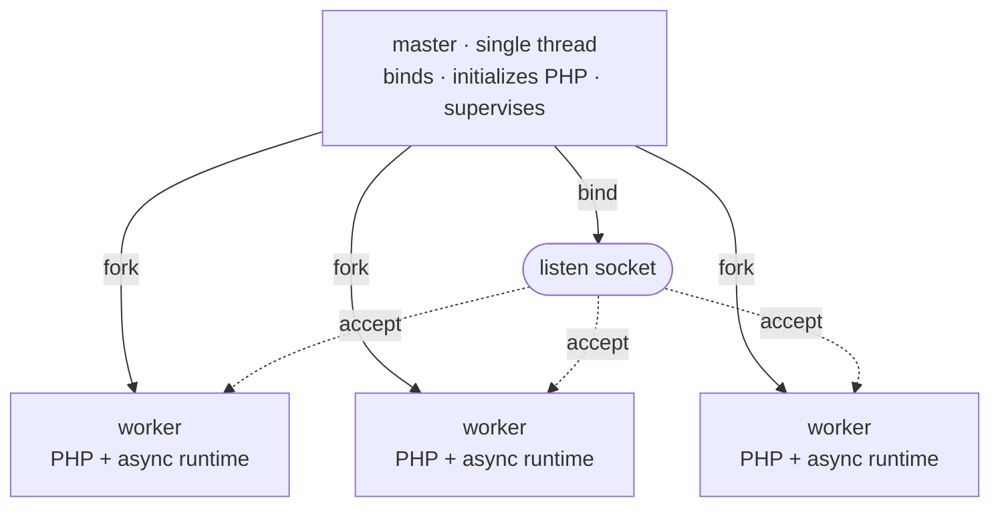

# Modelo de procesos

Rapira ejecuta un proceso maestro y un pool de workers para cada protocolo activado. El maestro mantiene los sockets de escucha, el motor PHP inicializado y el pidfile. Después, el maestro crea los procesos worker. Cada worker hereda PHP y acepta conexiones desde el socket compartido de su pool. Rapira no pasa una petición entre procesos.

HTTP y [gRPC](./grpc) tienen escuchas, scripts de entrada y pools separados. `[http.pool]` y `[grpc.pool]` los configuran de forma independiente. El pool gRPC usa el modo Dispatcher y procesa una llamada activa por worker.

Cuando la configuración tiene una tabla `[observability]`, el maestro también inicia un proceso para las métricas y las comprobaciones de salud. Este proceso no ejecuta código PHP. En Linux, su nombre de proceso es `rapira-obs`, y los workers PHP tienen el nombre `rapira-worker`. El maestro supervisa y detiene este proceso junto con los workers PHP. Una recarga no lo cambia, porque no tiene ninguna aplicación que reiniciar. Consulta [Métricas y comprobaciones de salud](/es/docs/observability) para más información.

Este modelo de procesos es el mismo en los modos [Classic](/es/docs/classic), [Worker](/es/docs/worker) y [Dispatcher](/es/docs/dispatcher). `http.pool.mode` controla el procesamiento de las peticiones dentro de un worker. Este ajuste no cambia la creación del pool, la supervisión ni las recargas. Consulta [Modos de ejecución](/es/docs/execution-modes) para más información.

## Maestro y workers

La inicialización sigue este orden:

1. **Enlazar el socket o los sockets de escucha.** Un conflicto de puerto detiene la inicialización antes de que PHP se inicie.
2. **Iniciar PHP una vez.** El maestro ejecuta `MINIT` en su único hilo. OPcache crea su memoria compartida en este momento, y cada worker la hereda. Cuando un worker compila un archivo, los otros workers usan el resultado en caché.
3. **Hacer fork de los workers.** Cada hijo hereda el socket enlazado y el motor inicializado.



El diagrama muestra un pool. Cada worker ejecuta un intérprete PHP NTS y un servidor HTTP o gRPC asíncrono. El servidor usa hyper sobre un runtime de tokio propio, con dos hilos. Cada worker llama a `accept()` en el socket que ha heredado. El sistema operativo asigna cada conexión nueva a un worker.

El maestro no atiende peticiones. Su único hilo espera señales, salidas de workers y temporizadores.

::: info
El maestro mantiene el módulo PHP durante toda su vida. Solo el maestro cierra el módulo. Un worker termina, pero no cierra este estado compartido del motor.
:::

## Supervisión

El maestro ejecuta el mantenimiento una vez por segundo. También procesa cada salida de un worker cuando ocurre.

- **Sustitución de workers.** Después de una salida normal, el maestro sustituye el worker inmediatamente. Después de un fallo o de una salida unhealthy, la espera de sustitución empieza en 100 ms. La espera se duplica tras cada fallo consecutivo y se detiene en 25,6 segundos. Un worker que funciona al menos 10 segundos reinicia la espera.
- **Arranques fallidos.** En los modos Worker y Dispatcher, un arranque falla cuando el script de entrada termina antes de recibir una petición. Después, el worker espera hasta 5 segundos y vuelve a ejecutar el script de entrada. Responde a una petición que llega durante la espera con HTTP `503` o gRPC `UNAVAILABLE`. Después de cinco arranques fallidos consecutivos, el worker termina como unhealthy.
- **Parada del maestro por arranque fallido.** El maestro se detiene con el código de salida 70 cuando termina un worker unhealthy. Esta regla solo se aplica cuando el pool no tiene ninguna petición correcta ni ningún worker idle o active. En todos los demás casos, el maestro sustituye el worker después de la espera de sustitución. Una terminación inesperada de un worker nunca detiene el maestro.
- **Límites de peticiones.** En los modos Worker y Dispatcher, `http.pool.max_requests` limita las peticiones de una instancia de la aplicación. Después de un número aleatorio de peticiones entre `max_requests + 1` y aproximadamente `1.5 × max_requests`, el worker reinicia su aplicación. El proceso del worker, sus conexiones y su cola se mantienen. La siguiente petición espera a que la aplicación arranque. El rango aleatorio evita reinicios simultáneos. El modo Classic ignora este ajuste, porque cada petición se ejecuta en una petición PHP nueva.
- **Tiempo límite de petición.** Con `http.pool.request_terminate_timeout_secs`, el maestro envía `SIGTERM` a un worker cuando su petición actual supera el límite. Si el worker sigue activo en el siguiente mantenimiento, el maestro envía `SIGKILL`. Después, el maestro sustituye el worker inmediatamente. El maestro no aplica este límite durante una parada.
- **Límite de memoria.** Con `http.pool.max_memory_mb`, el maestro lee la memoria residente (RSS) de cada worker en cada mantenimiento. Cuando la RSS supera el límite, el maestro envía `SIGQUIT` al worker una vez. El worker deja de aceptar trabajo nuevo, termina sus peticiones actuales y sale. Después, el maestro sustituye el worker inmediatamente. La salida libera toda la memoria del proceso worker, también la memoria fuera de PHP. Un reinicio de la aplicación en el mismo proceso no siempre reduce la RSS, porque PHP conserva parte de su memoria liberada para reutilizarla. El maestro no aplica este límite durante una parada.
- **Control del maestro.** Cada worker lee de un pipe que el maestro mantiene abierto. Si el maestro termina, cada worker deja de aceptar trabajo nuevo, termina sus peticiones actuales y sale.

## Tamaño del pool

Los ajustes siguientes usan `[http.pool]`. Los mismos ajustes se aplican a `[grpc.pool]`.

`http.pool.processes` establece el número de workers. El maestro crea estos workers durante la inicialización y sustituye cada worker que termina. El valor predeterminado es un worker por cada CPU que el proceso puede usar. Si un contenedor tiene un límite de CPU, el valor predeterminado sigue ese límite.

El total de workers de todos los pools debe ser 4096 o menos. Cuando la observabilidad está activada, su proceso cuenta como un worker. Un total mayor detiene Rapira con el código de salida 70.

PHP es síncrono, por lo que cada worker procesa una petición cada vez. Las aplicaciones con mucha E/S pueden requerir más workers que núcleos de CPU. Las aplicaciones limitadas por CPU normalmente no los requieren.

El número de workers no cambia mientras el servidor está en marcha. Para adaptar la capacidad a la carga, cambia el número de instancias de Rapira, por ejemplo con un orquestador de contenedores.

Consulta la [configuración](/es/docs/configuration) para ver la referencia completa de claves.

## Señales

Las señales detienen un servidor en marcha, lo recargan y le hacen informar de su estado. Todas van al **maestro**.

| Señal | Qué hace el maestro |
| --- | --- |
| `SIGTERM`, `SIGINT` | El maestro deja terminar las peticiones actuales y después detiene los workers. Una segunda señal fuerza la parada de los workers. |
| `SIGQUIT` | El maestro hace la misma parada ordenada. Otro `SIGQUIT` no tiene efecto. |
| `SIGUSR2`, `SIGHUP` | El maestro indica a cada worker que reinicie su aplicación. No se sustituye ningún proceso de worker. |
| `SIGUSR1` | El maestro escribe el estado del pool en el registro. |

Define `supervisor.pidfile` para dar a los scripts una ubicación fija del identificador del proceso maestro:

```bash
kill -USR2 $(cat /run/rapira.pid)   # Reiniciar la aplicación en cada worker.
kill -USR1 $(cat /run/rapira.pid)   # Escribir el estado del pool en el registro.
kill -TERM $(cat /run/rapira.pid)   # Detener después de terminar las peticiones actuales.
```

::: warning
Envía las señales solo al maestro. Los workers ignoran `SIGUSR1`. `SIGUSR2` hace que un worker reinicie su aplicación. `SIGTERM` y `SIGHUP` detienen un worker inmediatamente y cortan sus peticiones actuales. El tiempo límite de petición usa `SIGTERM`. Una señal directa a un worker evita la supervisión del maestro.

`Ctrl-C` en un terminal envía `SIGINT` al maestro y a todos los workers. Después, cada worker también recibe `SIGQUIT` del maestro. Una segunda señal de parada hace que un worker salga inmediatamente con el código 131, así que sus peticiones actuales no terminan. Para dejar terminar las peticiones actuales, envía `SIGTERM` solo al maestro.
:::

### Parar el servidor

Después de una señal de parada, el maestro envía inmediatamente `SIGQUIT` a cada worker. Los workers dejan de aceptar conexiones nuevas y terminan las peticiones actuales. Cada worker conserva las conexiones que tiene. Responde a la siguiente petición de cada conexión con `Connection: close`, y después la conexión se cierra. Después de `supervisor.process_control_timeout_secs`, el maestro envía `SIGTERM` a los workers restantes. El límite predeterminado es 30 segundos. Si quedan workers, el maestro envía `SIGKILL` un segundo después de `SIGTERM`.

El plazo de drenaje de las conexiones es el tiempo límite de control menos el menor valor entre cinco segundos y la mitad de ese límite. Con los ajustes predeterminados, las conexiones tienen 25 segundos para terminar. Las respuestas que superen este plazo pueden interrumpirse. Una conexión que queda inactiva durante todo el plazo se cierra cuando el plazo termina.

Un segundo `SIGTERM` o `SIGINT` salta la espera y fuerza la salida inmediatamente. Consulta [Códigos de salida](/es/docs/cli#codigos-de-salida) para ver los códigos de salida del maestro.

### Una recarga reinicia las aplicaciones

`SIGUSR2` o `SIGHUP` reinicia la aplicación en cada worker de cada pool. El worker termina la petición PHP de la aplicación y ejecuta otra vez el script de entrada en el mismo proceso. El socket de escucha, las conexiones y las peticiones en cola se mantienen. La aplicación antigua atiende las peticiones que esperan en la cola antes de la señal. Las peticiones posteriores van a la aplicación nueva.

En el modo Classic, cada petición ejecuta el script de entrada en una petición PHP nueva, así que el código nuevo funciona sin recarga. Los modos Worker y Dispatcher mantienen la aplicación en memoria. Recarga el pool después de cada despliegue en estos modos. Con `opcache.validate_timestamps = 0`, una recarga no carga código nuevo en ningún modo, porque los workers usan la memoria de OPcache del maestro. En este caso, reinicia Rapira. Consulta [despliegue](/es/docs/deployment) para más información.

Cada worker reinicia su aplicación por su cuenta. Cuando todos los workers se reinician al mismo tiempo, cada cola espera un arranque de la aplicación. Un cliente no nota el reinicio, salvo esta espera.

El maestro ignora una señal de recarga durante una parada. No registra la señal ignorada.

::: info
Una recarga reinicia las aplicaciones, pero no los procesos. Los workers conservan el mismo motor inicializado. Reinicia Rapira para aplicar cambios en el binario o en los archivos que lee el maestro, como `rapira.toml` y `php.ini`.
:::

### Escribir el estado en el registro

`SIGUSR1` hace que el maestro escriba el estado de cada pool en el registro. La primera línea de un pool muestra el número de workers en marcha e idle. Después, una línea por cada plaza de worker muestra el identificador del proceso, el estado y tres contadores:

```text
status: http pool: 4 running, 3 idle
  slot 0 pid 4242 state 2 handled 1500 errors 2 recycles 0
```

| Estado | Significado |
| --- | --- |
| `1` | Iniciando. La aplicación todavía no ha arrancado, o su último arranque falló. |
| `2` | Idle. El worker espera trabajo. |
| `3` | Active. El worker procesa una petición. |
| `4` | Drenando. El worker termina su trabajo y sale. |

Una plaza conserva sus contadores cuando el maestro sustituye su worker. `recycles` cuenta los reinicios de la aplicación dentro de un worker, por ejemplo después de `max_requests` o de una recarga.

::: tip
La salida de estado usa `info` en el target `master`. El nivel de registro predeterminado es `error`. Establece este target en `info` para mostrar la salida:

```toml
[log.targets]
master = "info"
```

El mismo target contiene errores de creación de workers y advertencias de tiempo límite de petición. Consulta [registro](/es/docs/logging) para más información.
:::

::: question ¿Usa Rapira transparent huge pages?
No. En Linux, el maestro desactiva las transparent huge pages para su propio proceso antes de que PHP se inicie. Los workers y los procesos que PHP inicia con `proc_open()` o `exec()` heredan este ajuste. Por eso, `USE_ZEND_ALLOC_HUGE_PAGES=1` y `opcache.huge_code_pages` no obtienen transparent huge pages. Estas opciones todavía pueden usar huge pages explícitas que el host reserva con `vm.nr_hugepages`. Ningún ajuste cambia este comportamiento.
:::

::: question ¿Puede el maestro ejecutarse como PID 1 en un contenedor?
Sí. Como PID 1, el maestro procesa las señales de parada y recoge todos los procesos hijos que terminan. No necesitas un proceso init separado.
:::
