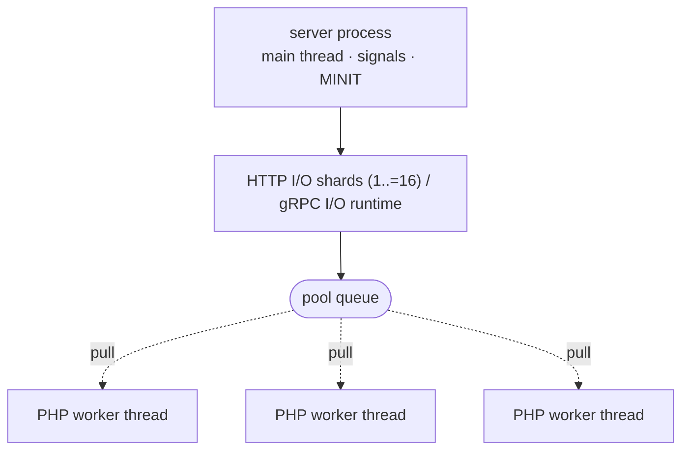

# Model procesów

Rapira uruchamia jeden proces serwera dla wszystkich włączonych protokołów. Proces zarządza nasłuchami, zainicjalizowanym silnikiem PHP, plikiem pidfile oraz jedną pulą workerów dla każdego włączonego protokołu. Każda pula ma ograniczoną kolejkę i stałą liczbę bezpiecznych wątkowo (ZTS) wątków workerów PHP.

HTTP i [gRPC](/pl/docs/grpc) mają osobne nasłuchy, skrypty wejściowe, kolejki i pule. `[http.pool]` i `[grpc.pool]` konfigurują je niezależnie. Pula gRPC używa trybu Dispatcher i obsługuje jedno aktywne wywołanie na workera.

Gdy konfiguracja zawiera tabelę `[observability]`, Rapira uruchamia nasłuch w osobnym wątku (`rapira-obs`) w tym samym procesie. Ten wątek nie wykonuje kodu PHP. Przeładowanie go nie zmienia, ponieważ nie ma on aplikacji do ponownego uruchomienia. Więcej informacji zawiera strona [Metryki i kontrole stanu](/pl/docs/observability).

Ta architektura jest taka sama w trybach [Classic](/pl/docs/classic), [Worker](/pl/docs/worker) i [Dispatcher](/pl/docs/dispatcher). `http.pool.mode` steruje przetwarzaniem żądań wewnątrz wątku workera. Nie zmienia tworzenia puli, ponownego uruchamiania aplikacji ani przeładowań. Więcej informacji zawiera strona [Tryby wykonania](/pl/docs/execution-modes).

## Serwer i workery

Inicjalizacja przebiega w tej kolejności:

1. **Walidacja konfiguracji i limitów NTS.** W kompilacji NTS Rapira odrzuca drugą pulę PHP i ogranicza pojedynczą pulę do jednego workera.
2. **Powiązanie gniazd nasłuchujących.** Konflikt portu zatrzymuje inicjalizację przed uruchomieniem PHP.
3. **Jednorazowy start PHP.** Wątek główny wykonuje `MINIT` i inicjalizuje OPcache we współdzielonej pamięci procesu.
4. **Uruchomienie środowisk I/O i wątków workerów.** Każda pula tworzy skonfigurowaną liczbę wątków workerów PHP.



Wtyczka HTTP uruchamia dedykowane jednowątkowe shardy I/O, po jednym na CPU w zakresie `1..=16`. Wtyczka gRPC używa wielowątkowego środowiska I/O z jednym wątkiem na CPU. Serwery obsługujące tylko HTTP używają jednowątkowego środowiska sterującego. Każdy wątek workera PHP pobiera jednostki pracy z kolejki swojej puli.

W modelu ZTS każdy wątek workera PHP ma własny katalog roboczy i lokalną dla wątku warstwę `putenv()`. Identyfikator procesu, `umask()` i `setlocale()` są współdzielone między wszystkimi wątkami w procesie serwera. Kompilacja zlinkowana z PHP NTS uruchamia jednego workera, zapisuje ostrzeżenie w logu, jeśli `workers` ma większą wartość, i odrzuca drugą pulę PHP.

::: info
Serwer zamyka moduł PHP w wątku głównym po zakończeniu wszystkich wątków workerów PHP.
:::

## Zarządzanie pulą {#pool-management}

- **Nieudane rozruchy.** W trybach Worker i Dispatcher rozruch jest nieudany, gdy skrypt wejściowy kończy się przed otrzymaniem jednostki pracy. Opóźnienie ponownej próby zaczyna się od 500 ms, podwaja po każdym kolejnym nieudanym rozruchu i zatrzymuje na 5 sekundach. Jednostka pracy przychodząca w czasie oczekiwania nie przyspiesza kolejnego rozruchu; dopóki żaden worker w puli nie jest gotowy, jednostki w kolejce otrzymują HTTP `503` lub gRPC `UNAVAILABLE`. Udany rozruch zeruje licznik błędów i opóźnienie.
- **Zatrzymanie po nieudanym rozruchu.** `max_boot_failures` ogranicza liczbę kolejnych nieudanych rozruchów (domyślnie `5`; `0` wyłącza limit). Gdy worker osiągnie limit, zanim jego pula obsłuży jakąkolwiek jednostkę pracy, Rapira kończy działanie z kodem `70`. Po obsłużeniu jednostki pracy przez pulę worker ponawia próby z narastającym opóźnieniem zamiast zatrzymywać serwer.
- **Ponowne uruchamianie aplikacji.** W trybach Worker i Dispatcher `max_requests` ogranicza liczbę jednostek pracy jednej instancji aplikacji. Po losowej liczbie z przedziału od `max_requests + 1` do około `1.5 × max_requests` worker ponownie uruchamia aplikację w tym samym wątku. Nasłuchy, połączenia i kolejka puli pozostają. Tryb Classic ignoruje ten klucz.
- **Watchdog limitu czasu żądania.** `request_terminate_timeout_secs` ustawia limit czasu rzeczywistego dla jednej jednostki pracy. Po osiągnięciu limitu watchdog przerywa PHP i wybudza zablokowany zapis odpowiedzi. Natywne operacje I/O mogą nadal czekać, więc ustaw limity czasu na gniazdach i zapytaniach do baz danych. Po kolejnych pięciu sekundach Rapira zapisuje raz w logu nadal zablokowanego workera, podczas gdy pozostałe workery dalej obsługują żądania. Rapira kończy działanie z kodem `124` tylko wtedy, gdy wszystkie workery w jednej puli pozostają zablokowane po upływie okresu dodatkowego.
- **Sygnał watchdoga (`SIGRTMAX`).** Na Linuksie i innych platformach obsługujących `SIGRTMAX` włączony watchdog rezerwuje `SIGRTMAX` przed startem workerów. Uruchomienie kończy się błędem, jeśli wątek główny go blokuje albo proces już go obsługuje lub ignoruje. Aplikacje i rozszerzenia muszą pozostawić `SIGRTMAX` dostępny. macOS używa flag przerwań PHP bez natywnego sygnału wybudzenia.
- **Zegary wykonania (`execution_clock`).** Na Linuksie z zegarami PHP na wątek `max_execution_time` domyślnie liczy czas rzeczywisty i wstrzymuje odliczanie podczas czekania na pracę lub miejsce w strumieniu odpowiedzi. Ustaw `execution_clock = "cpu"` w puli, aby liczyć tylko czas CPU wątku workera, dzięki czemu `sleep()` i oczekiwanie na bazę danych nie zużywają limitu. Bez zegarów na wątek i z wieloma workerami Rapira ustawia `max_execution_time=0` oraz `max_input_time=-1`, podczas gdy `request_terminate_timeout_secs` nadal obowiązuje.

## Rozmiar puli

Poniższe ustawienia używają `[http.pool]`. Te same ustawienia dotyczą `[grpc.pool]`.

`http.pool.workers` ustawia liczbę wątków workerów. Domyślna wartość to jeden worker na każdy procesor, którego proces może używać. Jeśli kontener ma limit procesora, wartość domyślna uwzględnia ten limit.

PHP działa synchronicznie, więc każdy wątek workera obsługuje jedną jednostkę pracy naraz. Aplikacje ograniczone przez operacje wejścia i wyjścia mogą wymagać więcej workerów niż rdzeni procesora. Aplikacje ograniczone przez procesor zwykle ich nie wymagają.

Liczba workerów nie zmienia się podczas działania serwera. Aby zmienić wydajność wraz z obciążeniem, zmień liczbę instancji Rapiry, na przykład za pomocą orkiestratora kontenerów.

Pełny wykaz kluczy zawiera [Konfiguracja](/pl/docs/configuration).

## Sygnały {#signals}

Sygnały zatrzymują działający serwer, przeładowują go i każą mu zgłosić swój stan. Wysyłaj sygnały do procesu `rapira`:

| Sygnał | Co robi serwer |
| --- | --- |
| `SIGTERM`, `SIGINT` | Zamyka nasłuchy, obsługuje otwarte połączenia do końca i zatrzymuje workery. Drugi sygnał `SIGTERM` lub `SIGINT` wymusza wyjście z kodem `130`. |
| `SIGQUIT` | Wykonuje to samo wygaszanie i zatrzymanie. Drugi `SIGQUIT` nie wywołuje żadnego efektu. |
| `SIGUSR2`, `SIGHUP` | Przeładowuje aplikację w każdym workerze każdej puli. |
| `SIGUSR1` | Zapisuje stan pul i workerów do logu. |

Ustaw `server.pidfile`, aby skrypty miały stałe miejsce z identyfikatorem procesu serwera:

```bash
kill -USR2 $(cat /run/rapira.pid)   # Przeładuj aplikację w każdym workerze.
kill -USR1 $(cat /run/rapira.pid)   # Zapisz stan puli do logu.
kill -TERM $(cat /run/rapira.pid)   # Zatrzymaj po obsłużeniu otwartych połączeń.
```

### Zatrzymywanie

Po sygnale `SIGTERM`, `SIGINT` lub `SIGQUIT` Rapira zamyka nasłuchy i przestaje przyjmować nowe połączenia. Otwarte połączenia mają czas na zakończenie przez `[server].stop_timeout_secs` minus pięć sekund lub przez połowę limitu, jeśli wynosi on poniżej dziesięciu sekund. Domyślny limit zatrzymywania to 30 sekund, co daje 25 sekund na obsługę bieżących połączeń i 5 sekund na zamknięcie PHP.

Gdy upłynie limit czasu zatrzymywania, Rapira kończy działanie natychmiast. Drugi sygnał `SIGTERM` lub `SIGINT` podczas zamykania połączeń wymusza natychmiastowe wyjście z kodem `130`. Wszystkie kody wyjścia opisuje sekcja [Kody wyjścia](/pl/docs/cli#exit-codes).

### Przeładowanie uruchamia aplikacje ponownie {#a-reload-restarts-the-apps}

`SIGUSR2` lub `SIGHUP` uruchamia aplikację ponownie w każdym workerze każdej puli. Przed ponownym uruchomieniem skryptu wejściowego worker rozwiązuje dowiązania symboliczne w ścieżce skryptu wejściowego, czyści pamięć podręczną realpath PHP i przechodzi do rozwiązanego katalogu skryptu. Nasłuchy, połączenia i jednostki w kolejce pozostają.

W trybie Classic każde żądanie uruchamia skrypt wejściowy w nowym żądaniu PHP. Dlatego zmieniony plik działa bez przeładowania, z wyjątkiem `opcache.validate_timestamps = 0`. Wdrożenie, które przełącza dowiązanie symboliczne w ścieżce skryptu wejściowego, wymaga przeładowania we wszystkich trybach, także w trybie Classic. Tryby Worker i Dispatcher trzymają aplikację w pamięci, więc przeładuj pulę po każdym wdrożeniu. Więcej informacji zawiera [Wdrożenie produkcyjne](/pl/docs/deployment).

Przeładowanie resetuje OPcache, więc aplikacje wczytują nowy kod także przy `opcache.validate_timestamps = 0`. Wartość `manual_restarts` z `opcache_get_status()` liczy te przeładowania. Jeden worker wykonuje `opcache_reset()`, gdy pozostałe czekają, a kolejne żądania ponownie kompilują zmienione skrypty. Przy `opcache.file_cache` i `opcache.validate_timestamps = 0` przeładowanie nie wczytuje nowego kodu zmienionego pliku w żadnym trybie: zobacz [wdrożenie produkcyjne](/pl/docs/deployment).

Rapira ignoruje sygnały przeładowania podczas zatrzymywania.

::: info
Przeładowanie ponownie uruchamia aplikacje, ale nie restartuje procesu serwera. Uruchom Rapirę ponownie, aby zastosować zmiany w pliku binarnym, `rapira.toml`, `php.ini`, `grpc.descriptor_set`, `grpc.auth.tokens_file` lub w plikach wczytywanych przez `opcache.preload`.
:::

OPcache planuje ponowne uruchomienie, gdy kod aplikacji wywołuje `opcache_reset()` lub gdy pamięć podręczna jest pełna. Rapira przeładowuje wtedy każdą pulę i zapisuje ostrzeżenie w logu. W Rapirze domyślna wartość `opcache.force_restart_timeout` to `0`, a wartość w `php.ini` ją zastępuje. Zostaw wartość `0`, aby OPcache nie zabił aktywnych workerów podczas ponownego uruchomienia.

### Zapisywanie stanu do logu

`SIGUSR1` zapisuje stan każdej puli i workera do logu w celu `rapira` na poziomie `info`:

```text
pool=http workers=4 pending=0 failed_on_full_queue=0 refused=0
pool=http worker=0 state=idle handled=1500 errors=2 recycles=0 last_activity_ms=42100
```

| Stan | Znaczenie |
| --- | --- |
| `starting` | Aplikacja jeszcze nie zakończyła rozruchu albo jej ostatni rozruch się nie udał. |
| `idle` | Worker czeka na pracę. |
| `active` | Worker przetwarza jednostkę pracy. |
| `draining` | Worker kończy swoją pracę i zatrzymuje się. |

`recycles` liczy ponowne uruchomienia aplikacji w tym wątku workera, na przykład po `max_requests`, błędzie krytycznym lub przeładowaniu.

::: tip
Zapis stanu używa poziomu `info` w celu `rapira`. Domyślny poziom logowania to `error`. Ustaw ten cel na `info`, aby pokazać zapis:

```toml
[log.targets]
rapira = "info"
```

Więcej informacji zawiera strona [Logi](/pl/docs/logging).
:::

::: question Czy Rapira używa przezroczystych dużych stron (transparent huge pages)?
Nie. W systemie Linux Rapira wyłącza przezroczyste duże strony dla swojego procesu, zanim wystartuje PHP. Procesy potomne, które PHP uruchamia przez `proc_open()` lub `exec()`, dziedziczą to ustawienie. Dlatego `USE_ZEND_ALLOC_HUGE_PAGES=1` i `opcache.huge_code_pages` nie dostają przezroczystych dużych stron. Te opcje mogą nadal używać jawnych dużych stron rezerwowanych przez `vm.nr_hugepages`.
:::

::: question Czy Rapira może działać jako PID 1 w kontenerze?
Nie. Uruchamiaj kontenery poleceniem `docker run --init`, aby proces init usuwał zakończone procesy potomne uruchomione przez PHP.
:::
