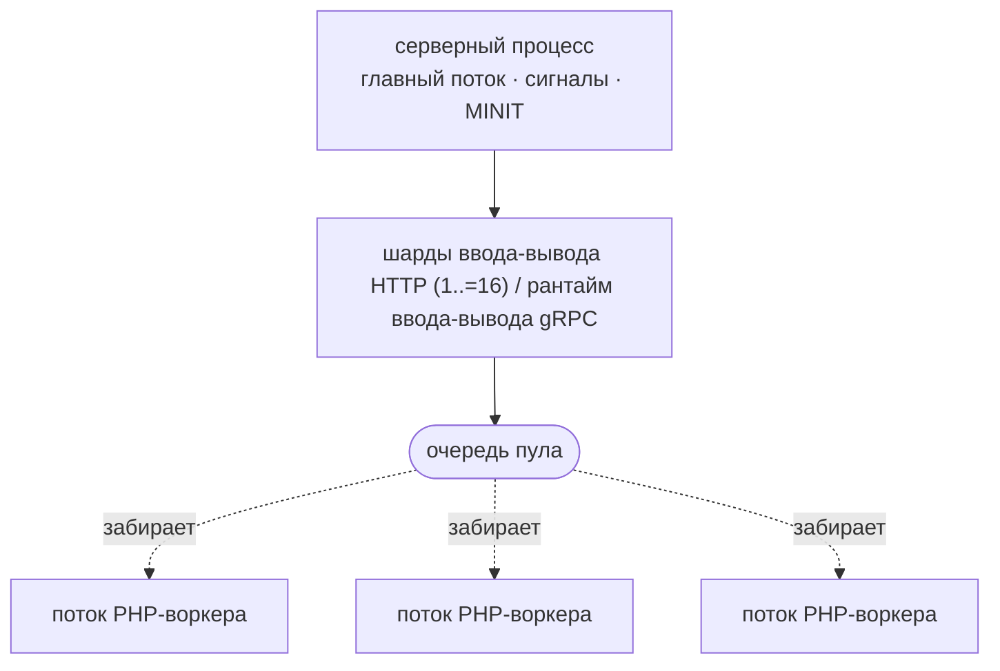

# Модель процессов

Rapira запускает один серверный процесс для всех включённых протоколов. Процесс владеет слушателями, инициализированным движком PHP, pid-файлом и одним пулом воркеров для каждого включённого протокола. У каждого пула есть ограниченная очередь и фиксированное число потоков потокобезопасных (ZTS) воркеров PHP.

HTTP и [gRPC](./grpc) имеют отдельные слушатели, входные скрипты, очереди и пулы. `[http.pool]` и `[grpc.pool]` настраивают их независимо. Пул gRPC использует режим Dispatcher и обрабатывает один активный вызов на воркер.

Если в конфигурации есть таблица `[observability]`, Rapira запускает слушатель в отдельном потоке (`rapira-obs`) внутри того же процесса. Этот поток не выполняет код PHP. Перезагрузка его не меняет, потому что у него нет приложения для перезапуска. Подробнее см. в разделе [Метрики и проверки состояния](/ru/docs/observability).

Эта архитектура одинакова в режимах [Classic](/ru/docs/classic), [Worker](/ru/docs/worker) и [Dispatcher](/ru/docs/dispatcher). `http.pool.mode` управляет обработкой запросов внутри потока воркера. Она не меняет создание пула, перезапуск приложения или перезагрузку. Подробнее см. в разделе [Режимы выполнения](/ru/docs/execution-modes).

## Сервер и воркеры

Инициализация выполняется в таком порядке:

1. **Проверить конфигурацию и ограничения NTS.** На сборке NTS Rapira отклоняет второй пул PHP и ограничивает единственный пул одним воркером.
2. **Занять слушающие сокеты.** Конфликт портов останавливает инициализацию до запуска PHP.
3. **Запустить PHP один раз.** Главный поток выполняет `MINIT` и инициализирует OPcache в общей памяти процесса.
4. **Запустить рантаймы ввода-вывода и потоки воркеров.** Каждый пул создаёт настроенные потоки PHP-воркеров.



Плагин HTTP запускает выделенные однопоточные шарды ввода-вывода, по одному на процессор, в диапазоне `1..=16`. Плагин gRPC использует многопоточный рантайм ввода-вывода с одним потоком на процессор. Серверы только с HTTP используют однопоточный управляющий рантайм. Каждый поток PHP-воркера забирает единицы работы из очереди своего пула.

При использовании ZTS каждый поток PHP-воркера имеет собственный рабочий каталог и локальный для потока слой `putenv()`. Идентификатор процесса, `umask()` и `setlocale()` общие для всех потоков в процессе сервера. Сборка, слинкованная с NTS PHP, запускает один воркер, записывает предупреждение в лог, если `workers` больше, и отклоняет второй пул PHP.

::: info
Сервер выполняет завершение модулей PHP в главном потоке после завершения всех потоков PHP-воркеров.
:::

## Управление пулом {#pool-management}

- **Сбои запуска.** В режимах Worker и Dispatcher запуск завершается сбоем, если входной скрипт заканчивается до получения единицы работы. Задержка повторной попытки начинается с 500 мс, удваивается после каждого последовательного сбоя запуска и останавливается на 5 секундах. Входящая во время ожидания единица работы не запускает следующую попытку досрочно; пока ни один воркер в пуле не готов, единицы работы в очереди получают HTTP `503` или gRPC `UNAVAILABLE`. Успешный запуск сбрасывает счётчик сбоев и задержку.
- **Остановка при сбое запуска.** `max_boot_failures` ограничивает число последовательных сбоев запуска (по умолчанию `5`; `0` отключает предел). Когда воркер достигает предела до того, как его пул обслужил хотя бы одну единицу работы, Rapira завершается с кодом `70`. После того как пул обслужил хотя бы одну единицу работы, воркер продолжает повторные попытки с экспоненциальной задержкой вместо остановки сервера.
- **Перезапуск приложения.** В режимах Worker и Dispatcher `max_requests` ограничивает число единиц работы одного экземпляра приложения. После случайного числа от `max_requests + 1` до примерно `1.5 × max_requests` воркер перезапускает приложение в том же потоке. Слушатели, соединения и очередь пула сохраняются. Режим Classic игнорирует этот ключ.
- **Таймер контроля времени запроса (watchdog).** `request_terminate_timeout_secs` задаёт предел реального времени для одной единицы работы. При достижении предела watchdog прерывает PHP и пробуждает заблокированную запись ответа. Нативный ввод-вывод может продолжать ожидание, поэтому задавайте таймауты на сокетах и вызовах к базам данных. Через пять секунд после этого Rapira один раз записывает в лог сообщение о всё ещё заблокированном воркере, пока остальные воркеры продолжают обслуживать запросы. Rapira завершается с кодом `124` только в том случае, если каждый воркер одного пула остаётся заблокированным после этого дополнительного интервала.
- **Сигнал watchdog (`SIGRTMAX`).** В Linux и на других платформах с `SIGRTMAX` включённый watchdog резервирует `SIGRTMAX` до запуска воркеров. Запуск завершается ошибкой, если главный поток блокирует этот сигнал либо процесс уже обрабатывает или игнорирует его. Приложения и расширения должны оставлять `SIGRTMAX` свободным. В macOS используются флаги прерывания PHP без нативного сигнала пробуждения.
- **Таймеры выполнения (`execution_clock`).** В Linux с попоточными таймерами PHP `max_execution_time` по умолчанию считает реальное время и приостанавливается во время ожидания работы или места в потоке ответа. Задайте `execution_clock = "cpu"` в пуле, чтобы считать только процессорное время потока воркера; тогда `sleep()` и ожидания базы данных не расходуют бюджет времени. Без попоточных таймеров и с несколькими воркерами Rapira задаёт `max_execution_time=0` и `max_input_time=-1`, но `request_terminate_timeout_secs` продолжает действовать.

## Размер пула

Следующие настройки используют `[http.pool]`. Те же настройки применяются к `[grpc.pool]`.

`http.pool.workers` задаёт число потоков воркеров. Значение по умолчанию равно одному воркеру на каждый процессор, который может использовать процесс. Если у контейнера есть ограничение по процессорам, значение по умолчанию следует этому ограничению.

PHP работает синхронно, поэтому каждый поток воркера обрабатывает одну единицу работы за раз. Приложениям с большим числом операций ввода-вывода может требоваться больше воркеров, чем ядер процессора. Приложениям с высокой нагрузкой на процессор обычно нет.

Число воркеров не меняется во время работы сервера. Чтобы менять ёмкость под нагрузку, меняйте число экземпляров Rapira, например с помощью оркестратора контейнеров.

Полный справочник ключей приведён в разделе [Конфигурация](/ru/docs/configuration).

## Сигналы {#signals}

Сигналы останавливают работающий сервер, перезагружают его и заставляют его сообщить своё состояние. Отправляйте сигналы процессу `rapira`:

| Сигнал | Что делает сервер |
| --- | --- |
| `SIGTERM`, `SIGINT` | Закрывает слушатели, завершает открытые соединения и останавливает воркеры. Второй `SIGTERM` или `SIGINT` принудительно завершает процесс с кодом `130`. |
| `SIGQUIT` | Выполняет такое же завершение соединений и остановку. Второй `SIGQUIT` не оказывает действия. |
| `SIGUSR2`, `SIGHUP` | Перезагружает приложение в каждом воркере каждого пула. |
| `SIGUSR1` | Записывает состояние пулов и воркеров в лог. |

Задайте `server.pidfile`, чтобы у скриптов было постоянное место для идентификатора процесса сервера:

```bash
kill -USR2 $(cat /run/rapira.pid)   # Перезапустить приложение в каждом воркере.
kill -USR1 $(cat /run/rapira.pid)   # Записать состояние пула в лог.
kill -TERM $(cat /run/rapira.pid)   # Остановить после завершения открытых соединений.
```

### Остановка

После `SIGTERM`, `SIGINT` или `SIGQUIT` Rapira закрывает слушатели и перестаёт принимать новые соединения. Открытые соединения завершаются в течение `[server].stop_timeout_secs` минус пять секунд или половины таймаута остановки, если он меньше десяти секунд. Таймаут остановки по умолчанию равен 30 секундам, что даёт окно 25 секунд на завершение соединений и 5 секунд на выключение PHP.

Когда таймаут остановки истекает, Rapira завершается немедленно. Второй `SIGTERM` или `SIGINT` во время завершения соединений вызывает принудительный немедленный выход с кодом `130`. Все коды завершения описаны в разделе [Коды завершения](/ru/docs/cli#exit-codes).

### Перезагрузка перезапускает приложения {#a-reload-restarts-the-apps}

`SIGUSR2` или `SIGHUP` перезапускает приложение в каждом воркере каждого пула. Перед повторным запуском входного скрипта воркер разрешает символические ссылки в пути входного скрипта, очищает кеш realpath PHP и переходит в разрешённый каталог скрипта. Слушатели, соединения и единицы работы в очереди сохраняются.

В режиме Classic каждый запрос выполняет входной скрипт в новом запросе PHP. Поэтому изменённый файл вступает в силу без перезагрузки, кроме случая `opcache.validate_timestamps = 0`. Развёртывание, которое переключает символическую ссылку в пути входного скрипта, требует перезагрузки во всех режимах, включая режим Classic. Режимы Worker и Dispatcher держат приложение в памяти, поэтому перезагружайте пул после каждого развёртывания. Подробнее см. в разделе [Запуск в продакшене](/ru/docs/deployment).

Перезагрузка сбрасывает OPcache, поэтому приложения загружают новый код также при `opcache.validate_timestamps = 0`. Значение `manual_restarts` в `opcache_get_status()` считает эти перезагрузки. Один воркер выполняет `opcache_reset()`, пока остальные воркеры ждут, а последующие запросы заново компилируют изменённые скрипты. При `opcache.file_cache` и `opcache.validate_timestamps = 0` перезагрузка не загружает новый код изменённого файла ни в одном режиме: см. раздел [Запуск в продакшене](/ru/docs/deployment).

Rapira игнорирует сигналы перезагрузки во время остановки.

::: info
Перезагрузка перезапускает приложения, но не перезапускает серверный процесс. Перезапустите Rapira, чтобы применить изменения бинарного файла, `rapira.toml`, `php.ini`, `grpc.descriptor_set`, `grpc.auth.tokens_file` или файлов, которые загружает `opcache.preload`.
:::

OPcache планирует перезапуск, когда код приложения вызывает `opcache_reset()` или когда кеш заполнен. Тогда Rapira перезагружает каждый пул и записывает предупреждение в лог. Под управлением Rapira значение по умолчанию для `opcache.force_restart_timeout` равно `0`, и значение в `php.ini` его переопределяет. Оставляйте значение `0`, чтобы OPcache не завершал активные воркеры во время перезапуска.

### Запись состояния в лог

`SIGUSR1` записывает состояние каждого пула и воркера в лог в цель `rapira` с уровнем `info`:

```text
pool=http workers=4 pending=0 failed_on_full_queue=0 refused=0
pool=http worker=0 state=idle handled=1500 errors=2 recycles=0 last_activity_ms=42100
```

| Состояние | Значение |
| --- | --- |
| `starting` | Приложение ещё не запустилось, или его последний запуск завершился сбоем. |
| `idle` | Воркер ждёт работу. |
| `active` | Воркер обрабатывает единицу работы. |
| `draining` | Воркер завершает свою работу и останавливается. |

`recycles` считает перезапуски приложения в этом потоке воркера, например после `max_requests`, фатальной ошибки или перезагрузки.

::: tip
Вывод состояния использует уровень `info` в цели `rapira`. Уровень логирования по умолчанию - `error`. Задайте для этой цели `info`, чтобы показать вывод:

```toml
[log.targets]
rapira = "info"
```

Подробнее см. в разделе [Логирование](/ru/docs/logging).
:::

::: question Использует ли Rapira прозрачные огромные страницы (transparent huge pages)?
Нет. В Linux Rapira отключает transparent huge pages для своего процесса до запуска PHP. Дочерние процессы, которые PHP запускает через `proc_open()` или `exec()`, наследуют эту настройку. Поэтому `USE_ZEND_ALLOC_HUGE_PAGES=1` и `opcache.huge_code_pages` не получают transparent huge pages. Эти опции всё ещё могут использовать явные огромные страницы, зарезервированные через `vm.nr_hugepages`.
:::

::: question Может ли Rapira работать как PID 1 в контейнере?
Нет. Запускайте контейнеры командой `docker run --init`, чтобы процесс init убирал завершившиеся дочерние процессы, запущенные PHP.
:::
