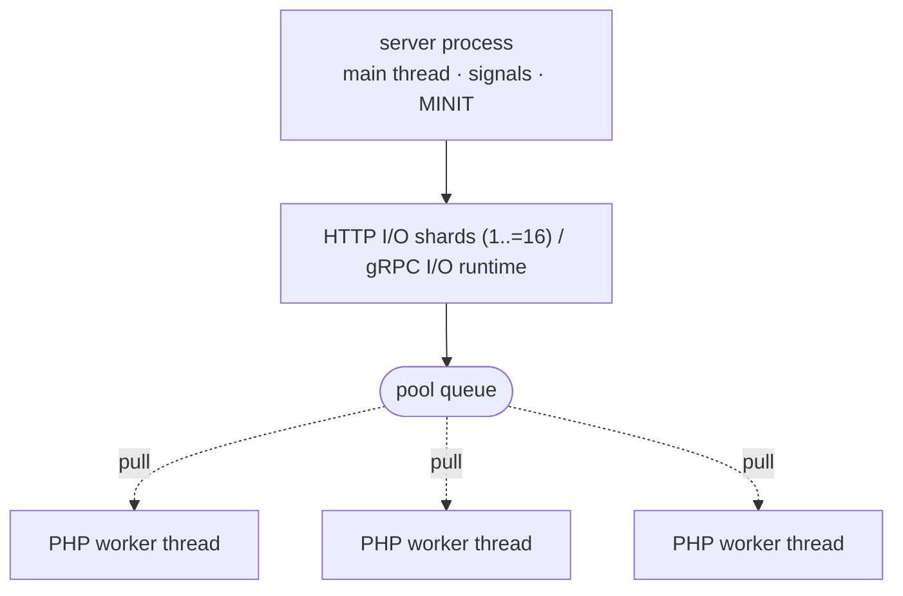

# 进程模型

Rapira 为所有启用的协议运行一个服务器进程。该进程持有监听器、已初始化的 PHP 引擎、pidfile，以及每个启用协议对应的一个 worker 进程池。每个进程池都有一个有界队列和固定数量的线程安全（ZTS）PHP worker 线程。

HTTP 和 [gRPC](/zh/docs/grpc) 有独立的监听器、入口脚本、队列和进程池。`[http.pool]` 和 `[grpc.pool]` 分别配置它们。gRPC 进程池使用 Dispatcher 模式，每个 worker 同时处理一个活动调用。

当配置中有 `[observability]` 表时，Rapira 会在同一进程内的独立线程（`rapira-obs`）上启动监听器。此线程不运行 PHP 代码。重载不会改变它，因为它没有需要重启的应用。更多内容见[指标和健康检查](/zh/docs/observability)。

在 [Classic](/zh/docs/classic)、[Worker](/zh/docs/worker) 和 [Dispatcher](/zh/docs/dispatcher) 模式下，此架构都相同。`http.pool.mode` 控制 worker 线程内部的请求处理。此设置不改变进程池的创建、回收或重载。更多内容见[执行模式](/zh/docs/execution-modes)。

## 服务器与 worker

初始化按以下顺序进行：

1. **验证配置与 NTS 限制。** 在 NTS 构建上，Rapira 拒绝第二个 PHP 进程池，并将单个进程池限制为一个 worker。
2. **绑定监听套接字。** 端口冲突会在 PHP 启动前停止初始化。
3. **只启动一次 PHP。** 主线程运行 `MINIT` 并在共享进程内存中初始化 OPcache。
4. **启动 I/O 运行时和 worker 线程。** 每个进程池生成其配置的 PHP worker 线程。



HTTP 插件运行专用的单线程 I/O 分片，每个 CPU 一个，限制在 `1..=16` 之间。gRPC 插件使用多线程 I/O 运行时，每个 CPU 一个线程。仅启用 HTTP 的服务器使用单线程控制运行时。每个 PHP worker 线程从其进程池队列拉取工作单元。

使用 ZTS 时，每个 PHP worker 线程有自己的工作目录和线程本地 `putenv()` 层。进程 ID、`umask()` 和 `setlocale()` 在服务器进程中的所有线程之间共享。链接到 NTS PHP 的构建只运行一个 worker，当 `workers` 更大时记录警告，并且会拒绝第二个 PHP 进程池。

::: info
服务器在所有 PHP worker 线程汇合（join）后，在主线程上运行 PHP 模块关闭。
:::

## 进程池管理 {#pool-management}

- **启动失败。** 在 Worker 和 Dispatcher 模式下，如果入口脚本在收到工作单元前结束，则启动失败。重试延迟从 500 ms 开始，每次连续启动失败后翻倍，并在 5 秒时停止增长。等待期间到达的工作单元不会提前触发下一次启动；当进程池中没有就绪的 worker 时，排队的工作单元收到 HTTP `503` 或 gRPC `UNAVAILABLE`。一次成功的启动会重置失败计数和延迟。
- **启动失败时停止。** `max_boot_failures` 限制连续启动失败次数（默认 `5`；`0` 禁用此限制）。当 worker 在其进程池处理任何工作单元前达到该限制时，Rapira 以退出码 `70` 退出。在进程池处理过工作单元之后，worker 会继续按退避延迟重试，而不是停止服务器。
- **应用回收。** 在 Worker 和 Dispatcher 模式下，`max_requests` 限制一个应用实例处理的工作单元数。在处理 `max_requests + 1` 到大约 `1.5 × max_requests` 之间的随机数量工作单元后，worker 在同一线程上回收其应用。监听器、连接和进程池队列保持不变。Classic 模式忽略此键。
- **请求超时看门狗。** `request_terminate_timeout_secs` 为一个工作单元设置墙钟时间上限。达到限制时，看门狗会中断 PHP 并唤醒阻塞的响应写入。原生 I/O 仍可能继续等待，因此请为套接字和数据库调用设置超时。再过五秒后，如果某个 worker 仍然阻塞，Rapira 会记录一次日志，同时其他 worker 继续提供服务。仅当某个进程池中的所有 worker 在宽限期过后仍处于阻塞状态时，Rapira 才以退出码 `124` 退出。
- **看门狗信号（`SIGRTMAX`）。** 在 Linux 和其他支持 `SIGRTMAX` 的平台上，启用看门狗会在 worker 启动前保留 `SIGRTMAX`。如果主线程阻塞了它，或者进程已经处理或忽略了它，启动会失败。应用和扩展必须保证 `SIGRTMAX` 可用。macOS 使用 PHP 中断标志，而不使用原生唤醒信号。
- **执行计时器（`execution_clock`）。** 在带有每线程 PHP 计时器的 Linux 上，`max_execution_time` 默认计算墙钟时间，并在等待工作或响应流空间时暂停。在进程池中设置 `execution_clock = "cpu"` 可仅计算 worker 线程的 CPU 时间，从而让 `sleep()` 和数据库等待不消耗该时间预算。在没有每线程计时器且有多个 worker 的情况下，Rapira 会设置 `max_execution_time=0` 和 `max_input_time=-1`，而 `request_terminate_timeout_secs` 仍然适用。

## 进程池大小

以下设置使用 `[http.pool]`。相同的设置也适用于 `[grpc.pool]`。

`http.pool.workers` 设置 worker 线程数量。默认值为进程可以使用的每个 CPU 一个 worker。如果容器有 CPU 限制，默认值遵循该限制。

PHP 是同步的，因此每个 worker 线程一次处理一个工作单元。I/O 密集型应用可能需要比 CPU 核心更多的 worker。CPU 密集型应用通常不需要。

服务器运行期间，worker 数量不会改变。要根据负载改变容量，请改变 Rapira 实例的数量，例如使用容器编排器。

完整的键参考见[配置](/zh/docs/configuration)。

## 信号 {#signals}

信号用来停止正在运行的服务器、重载它，以及让它报告自己的状态。向 `rapira` 进程发送信号：

| 信号 | 服务器的动作 |
| --- | --- |
| `SIGTERM`、`SIGINT` | 关闭监听器、排空打开的连接并停止 worker。第二个 `SIGTERM` 或 `SIGINT` 强制以退出码 `130` 退出。 |
| `SIGQUIT` | 执行相同的排空并停止。再发送 `SIGQUIT` 没有效果。 |
| `SIGUSR2`、`SIGHUP` | 在每个进程池的每个 worker 中重载应用。 |
| `SIGUSR1` | 将进程池和 worker 状态写入日志。 |

设置 `server.pidfile`，脚本就可以从一个固定位置读取服务器进程标识符：

```bash
kill -USR2 $(cat /run/rapira.pid)   # 在每个 worker 中重载应用。
kill -USR1 $(cat /run/rapira.pid)   # 将进程池状态写入日志。
kill -TERM $(cat /run/rapira.pid)   # 在打开的连接排空后停止。
```

### 停止

收到 `SIGTERM`、`SIGINT` 或 `SIGQUIT` 后，Rapira 关闭监听器并停止接受新连接。打开的连接在 `[server].stop_timeout_secs` 减去 5 秒的时间内排空；如果该超时低于 10 秒，则排空时间为超时的一半。默认停止超时为 30 秒，这提供 25 秒的排空窗口和 5 秒的 PHP 关闭时间。

当停止超时到期时，Rapira 立即退出。排空期间收到第二个 `SIGTERM` 或 `SIGINT` 会强制以退出码 `130` 立即退出。所有退出码见[退出码](/zh/docs/cli#exit-codes)。

### 重载会重启应用 {#a-reload-restarts-the-apps}

`SIGUSR2` 或 `SIGHUP` 会在每个进程池的每个 worker 中回收应用。在入口脚本再次运行之前，worker 会解析入口脚本路径中的符号链接，清除 PHP realpath 缓存，并进入解析后的脚本目录。监听器、连接和排队的工作单元保持不变。

在 Classic 模式下，每个请求都在新的 PHP 请求中运行入口脚本。因此，更改的文件无需重载即可生效，`opcache.validate_timestamps = 0` 时除外。切换入口脚本路径中符号链接的部署在所有模式下都需要重载，包括 Classic 模式。Worker 和 Dispatcher 模式将应用保留在内存中，因此在每次部署后都要重载。更多内容见[部署](/zh/docs/deployment)。

重载会重置 OPcache，因此在 `opcache.validate_timestamps = 0` 时应用也会加载新代码。`opcache_get_status()` 的 `manual_restarts` 值会统计这些重载。由一个 worker 执行 `opcache_reset()`，同时其他 worker 等待，随后的请求重新编译更改的脚本。使用 `opcache.file_cache` 且 `opcache.validate_timestamps = 0` 时，重载在任何模式下都不会加载更改文件的新代码：请参阅[部署](/zh/docs/deployment)。

Rapira 在停止期间忽略重载信号。

::: info
重载会回收应用，但不会重启服务器进程。要应用对二进制文件、`rapira.toml`、`php.ini`、`grpc.descriptor_set`、`grpc.auth.tokens_file` 或 `opcache.preload` 加载的文件的更改，请重启 Rapira。
:::

当应用代码调用 `opcache_reset()` 或缓存已满时，OPcache 会安排一次重启。Rapira 随后重载每个进程池并记录一条警告。在 Rapira 下，`opcache.force_restart_timeout` 的默认值为 `0`，`php.ini` 中的值会覆盖它。请保持值为 `0`，以便 OPcache 不会在重启期间终止活动的 worker。

### 将状态写入日志

`SIGUSR1` 以 `info` 级别在 `rapira` 目标上将每个进程池和 worker 的状态写入日志：

```text
pool=http workers=4 pending=0 failed_on_full_queue=0 refused=0
pool=http worker=0 state=idle handled=1500 errors=2 recycles=0 last_activity_ms=42100
```

| 状态 | 含义 |
| --- | --- |
| `starting` | 应用尚未启动，或者其上一次启动失败。 |
| `idle` | worker 等待工作。 |
| `active` | worker 正在处理工作单元。 |
| `draining` | worker 完成其工作并停止。 |

`recycles` 统计该 worker 线程上的应用回收次数，例如在 `max_requests`、致命错误或重载之后。

::: tip
状态输出使用 `rapira` 目标上的 `info` 级别。默认日志级别为 `error`。将此目标设为 `info` 以显示输出：

```toml
[log.targets]
rapira = "info"
```

更多内容见[日志](/zh/docs/logging)。
:::

::: question Rapira 使用透明大页吗？
不使用。在 Linux 上，Rapira 在 PHP 启动前为其自身进程关闭透明大页。PHP 用 `proc_open()` 或 `exec()` 启动的子进程继承此设置。因此，`USE_ZEND_ALLOC_HUGE_PAGES=1` 和 `opcache.huge_code_pages` 得不到透明大页。这些选项仍然可以使用通过 `vm.nr_hugepages` 预留的显式大页。
:::

::: question Rapira 可以在容器中作为 PID 1 运行吗？
不可以。请使用 `docker run --init` 运行容器，以便 init 进程回收 PHP 启动的已退出子进程。
:::
